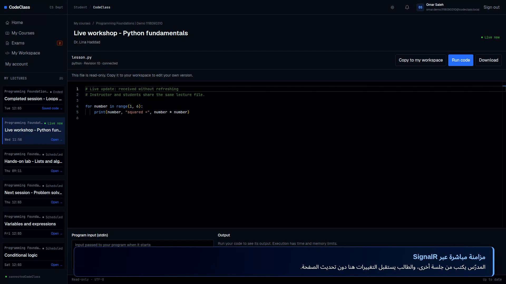
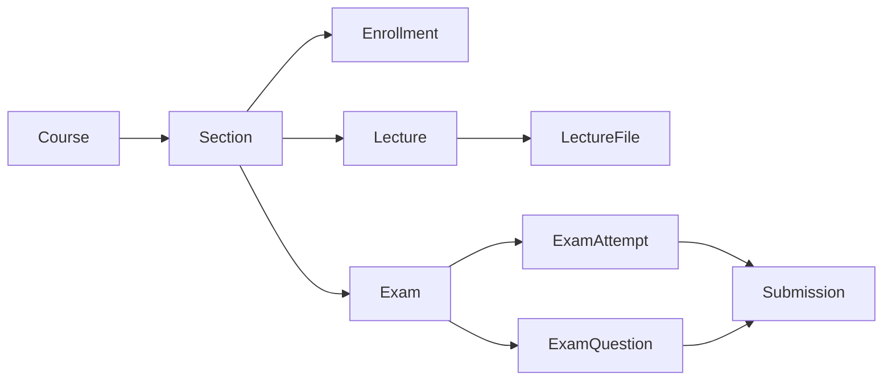

# CodeClass

A programming classroom with live code sharing, personal workspaces, and timed assessments reviewed by instructors.


[Features](#features) · [Run with Docker](#run-everything-with-docker-compose) · [Architecture](#architecture) · [Tests](#tests) · [Shared dialogs](#shared-dialogs)

[](artifacts/CodeClass-Full-Demo-1920x1080.mp4)

**[Watch the full walkthrough](artifacts/CodeClass-Full-Demo-1920x1080.mp4)** — 1920×1080, 30 fps, with Arabic explanations. The [demo guide](artifacts/CodeClass-Demo-Guide.md) includes chapter timestamps and local demonstration account settings.

## Features

| Area | What it provides |
|---|---|
| Accounts and roles | Administrator, instructor, and student access; account creation by authorized staff; profile and password management. |
| Courses and sections | Course organization, instructor assignment, and student enrollment with activation controls. |
| Lectures | Schedule a lecture, configure its code file, start the live session, and retain its code after the session ends. |
| Live collaboration | SignalR broadcasts committed code changes to everyone in the same file group, including the instructor. |
| Personal workspace | A code file owned by each user, automatic saving, file naming, language selection, downloads, and copying lecture code. |
| Code editor | Shared Monaco editor with syntax highlighting, completion suggestions, line numbers, and read-only views. |
| Code execution | Run C++, Python, and Java using Piston, with standard input, output, compilation errors, and execution limits. |
| Exams | Draft and publish exams, write questions with optional images, start timed attempts, and submit code once per question. |
| Grading | Instructors review submitted code and assign marks and feedback; students view their results. |
| Shared UI | Light/dark themes, toast messages, dialogs, confirmation prompts, role guards, and paginated lists. |

### Roles

- **Administrator:** manages accounts, courses, sections, and academic content.
- **Instructor:** manages assigned sections, enrollments, lectures, exams, and grading; can create student accounts.
- **Student:** accesses enrolled sections, reads lecture code, edits their personal file, and submits exam solutions.

The API enforces role and resource access independently of the frontend guards. Assessment marks are assigned by instructors.

## Run everything with Docker Compose

### Prerequisites

- Docker with Docker Compose v2.
- Internet access for container images and the initial Piston runtime installation.
- Available host ports `4000` for the application and `5341` for Seq, or different values in `.env`.

Docker builds the frontend and backend; a local Node.js or .NET SDK installation is not required for this setup.

### Create the environment file

From the project root:

```bash
cp .example.env .env
```

Replace the example secrets before starting. The file contains one variable per line:

```dotenv
# Application
ASPNETCORE_ENVIRONMENT=Development
FRONTEND_PORT=4000

# Databases
APPLICATION_DB_NAME=StepByStepCodingApplication
SECURITY_DB_NAME=StepByStepCodingSecurity
SA_PASSWORD=Replace_SQL@Passw0rd1

# JWT signing key: use at least 32 random characters
JWT_KEY=replace-with-a-random-secret-of-at-least-32-characters

# First administrator
ADMIN_SEED_ENABLED=true
ADMIN_FULL_NAME=CodeClass Admin
ADMIN_EMAIL=admin@codeclass.local
ADMIN_PASSWORD=Replace_Admin@Passw0rd1

# Redis
REDIS_PASSWORD=replace-with-a-long-random-redis-password

# Seq
SEQ_PORT=5341
SEQ_ADMIN_PASSWORD=Replace_Seq@Passw0rd1

# Code execution
CODE_EXECUTION_URL=http://piston:2000
PISTON_IMAGE=ghcr.io/engineer-man/piston@sha256:2f66b7456189c4d713aa986d98eccd0b6ee16d26c7ec5f21b30e942756fd127a
PISTON_CPP_VERSION=10.2.0
PISTON_PYTHON_VERSION=3.10.0
PISTON_JAVA_VERSION=15.0.2
```

SQL Server and administrator passwords must meet their password requirements. Compose injects these values into the application, including both SQL connection strings and the Redis connection string. Keep `.env` out of Git; `.example.env` contains shareable placeholders.

### First startup

Run these commands **from the project root**, in order:

1. **Build and start the services.** The `execution` profile includes Piston and its runtime installer.

   ```bash
   docker compose --profile execution up -d --build
   ```

2. **Create or update both databases.**

   ```bash
   docker compose run --rm --build migrations
   ```

   The migration service runs EF Core `database update` for `ApplicationSecurityDbContext` first, then `ApplicationDbContext`, using the connection strings supplied by Compose. `--rm` removes the temporary container after it exits; the database data and migration files remain.

3. **Stop the services after the database update.**

   ```bash
   docker compose --profile execution down
   ```

4. **Start the project with the databases ready.**

   ```bash
   docker compose --profile execution up -d
   ```

The API may restart during the initial bootstrap until the database migration step completes. On the final startup, the configured administrator is created when admin seeding is enabled and the account does not already exist.

Open **[http://localhost:4000](http://localhost:4000)** and sign in with `ADMIN_EMAIL` and `ADMIN_PASSWORD` from `.env`. The administrator can then create instructors and students and organize the courses and sections.

The demonstration accounts referenced by the video are local prepared data; a fresh database starts with the configured administrator.

### Services

| Service | Purpose | Address or lifecycle |
|---|---|---|
| `frontend` | Angular production build served by Nginx; proxies API and SignalR requests. | `http://localhost:4000` |
| `backend` | ASP.NET Core API, authentication, application handlers, and SignalR hub. | Internal port `8080`, reached through Nginx. |
| `sqlserver` | Application and security databases. | Persistent `sqlserver_data` volume. |
| `redis` | Server-side caching. | Internal service with password authentication. |
| `seq` | Structured application and request logs. | `http://localhost:5341`; initial user `admin`, password `SEQ_ADMIN_PASSWORD`. |
| `piston` | Program execution. | Enabled by the `execution` profile; no host port published. |
| `piston-setup` | Installs the configured language runtimes. | Exits after successful installation; packages are kept in a volume. |
| `migrations` | Applies both sets of EF Core migrations. | One-off `tools` profile service, invoked with `docker compose run`. |

Piston is configured with `privileged: true` for its runtime sandbox. Resource and execution limits are defined in [compose.yaml](compose.yaml) and the API's code execution options. A privileged container is not a security boundary from the Docker host.

### Useful commands

```bash
# Inspect services and first-time runtime installation
docker compose ps --all
docker compose logs -f piston-setup

# Follow API logs
docker compose logs -f backend

# Rebuild after code changes
docker compose --profile execution up -d --build

# Apply new database migrations
docker compose run --rm --build migrations

# Stop the project while retaining its data volumes
docker compose --profile execution down
```

The migration entry point is [migrate.sh](API/StepByStepCoding.Api/Scripts/migrate.sh). There are separate migration folders for [application data](Infrastructure/StepByStepCoding.Persistence/Migrations) and [Identity/security](Infrastructure/StepByStepCoding.Security/Migrations).

## Architecture

The backend follows Clean Architecture with feature folders for commands, queries, handlers, validators, and DTOs. It uses a custom mediator and Scrutor decorators.

```text
StepByStepCoding/
├── API/StepByStepCoding.Api/                 Controllers, SignalR, HTTP concerns
├── Core/
│   ├── StepByStepCoding.Domain/              Entities and business rules
│   └── StepByStepCoding.Application/         Features, contracts, mediator, decorators
├── Infrastructure/
│   ├── StepByStepCoding.EntityFrameworkCore/ Shared repository and unit of work
│   ├── StepByStepCoding.Persistence/         Academic DbContext, repositories, migrations
│   ├── StepByStepCoding.Security/            Identity, JWT, refresh tokens, admin seeding
│   └── StepByStepCoding.Infrastructure/      Redis and code execution integrations
├── FrontEnd/CodeClass/                       Angular application
├── Tests/StepByStepCoding.Security.Tests/    Backend tests
├── Docker/Piston/                           Runtime installation script
├── compose.yaml
└── .example.env
```

### Academic model



A lecture has one code file. A student has one attempt per exam and one submission per question in that attempt. A submission stores the submitted code, mark, reviewer, and feedback. Personal workspace files are owned by user ID. Identity users live in the separate security database.

### Request and data flow

- **API:** thin controllers send commands and queries through the mediator. Role attributes protect staff operations; academic access checks enforce ownership and enrollment using loaded entities.
- **Persistence:** repositories load untracked entities and perform database operations. The shared EF unit of work commits changes. `GetPageWithCount` returns the page and total count in one SQL command, including empty pages.
- **Pagination:** list responses have a consistent `{ items, totalCount }` body. The frontend stores loaded pages in a map keyed by page number, reuses saved pages, and resets state when filters or cache versions change.
- **Caching:** handler decorators use Redis for cacheable queries and invalidate shared prefixes after updates. The frontend HTTP interceptor manages its local response cache.
- **Authentication:** access and refresh tokens use HttpOnly cookies. `Me` verifies the current session. A saved user profile supports the initial shell; failed token refresh clears the profile and local session state.
- **Live code:** clients join a file group. The hub sends code changes through the save handler, then broadcasts committed changes to the group. Rapid editor events are sent in ordered batches within server limits.
- **Logging:** Serilog writes to console, file, and Seq; decorators add service and handler logs.

### Frontend organization

```text
src/app/
├── core/
│   ├── DTO/                       Backend response and request models
│   ├── guards/                    Authentication, roles, unsaved changes
│   ├── interceptors/              Authentication and response caching
│   ├── services/
│   │   ├── api/                   HTTP requests per resource
│   │   ├── data/                  Resource state and write workflows
│   │   ├── local/                 Theme, toasts, dialogs, memory cache
│   │   └── signalr/               Real-time connection
│   └── Utilities/                 Shared state and RxJS helpers
├── features/                      Route and feature components
├── shared/components/             Reusable UI and code editor
├── shared/directives/             Visibility-based lazy loading
└── layout/                        Main shell
```

Forms use `FormBuilder.nonNullable`, templates use modern Angular control flow, and colors are defined in `@theme` in [styles.css](FrontEnd/CodeClass/src/styles.css).

## Shared dialogs

[DialogComponent](FrontEnd/CodeClass/src/app/shared/components/dialog/dialog.component.ts) owns the native `<dialog>` element, heading, close button, backdrop, keyboard cancellation, and busy state. Feature components project their own HTML into this shell:

```html
@if (editing()) {
  <app-dialog
    heading="Edit course"
    [busy]="saving()"
    (closed)="editing.set(false)"
  >
    <form [formGroup]="form" (ngSubmit)="save()" class="space-y-5">
      <label class="form-label">
        Course name
        <input class="form-input mt-2" formControlName="name" />
      </label>
      <button class="button-primary" [disabled]="saving()">Save</button>
    </form>
  </app-dialog>
}
```

Import `DialogComponent` in the standalone component's `imports`. Saving disables dismissal so that an in-flight operation is not interrupted by Escape, the close button, or a backdrop click.

`ConfirmDialogComponent` builds confirmation content inside the same shell. Actions such as leaving an unsaved page or replacing workspace code can await `DialogService.confirm(...)`; the root application renders these confirmations through the shared dialog.

## Tests

Frontend tests use **Vitest and JSDOM**. They cover the dialog shell, confirmations, draft preservation, code-save batching, editor completions, pagination, caching, and exam workflows.

```bash
cd FrontEnd/CodeClass
npm ci
npm test
npm run typecheck
npm run build
```

Backend tests are **unit tests only**, using **xUnit**, **AutoFixture**, **FluentAssertions**, and **Moq**. Dependencies use `Mock<T>`; there are no custom fake services, custom fixture classes, running web hosts, database connections, or live Redis/Piston calls. With the .NET 10 SDK installed, run from the project root:

```bash
dotnet test StepByStepCoding.sln
```

Tests follow `// Arrange`, `// Act`, and `// Assert`, with related scenarios grouped in `#region` blocks. The shared `TestBase` configures AutoFixture with `OmitOnRecursionBehavior` so circular relationships are omitted. It writes arranged inputs and operation results through xUnit's `ITestOutputHelper`. Output serialization ignores cycles and has a depth limit. AutoFixture creates test data; `TestBase` only shares its configuration and output formatting.

To display output for passing tests as well:

```bash
dotnet test StepByStepCoding.sln --logger "console;verbosity=detailed"
```

These tests cover domain rules, course and file handlers, exam publishing, grading, academic access, authentication, token rotation, cache keys and decorators, controller responses, cookies, SignalR group targeting, Redis operations, and code-execution request mapping. HTTP execution tests mock `HttpMessageHandler`; they do not send network requests.

Current development note: `Invoke_MapsExceptionsWithoutExposingUnexpectedDetails` (with `unexpected = true`) fails while the API retains the temporary exception-message suffix used for debugging unexpected errors. The other backend tests pass.
